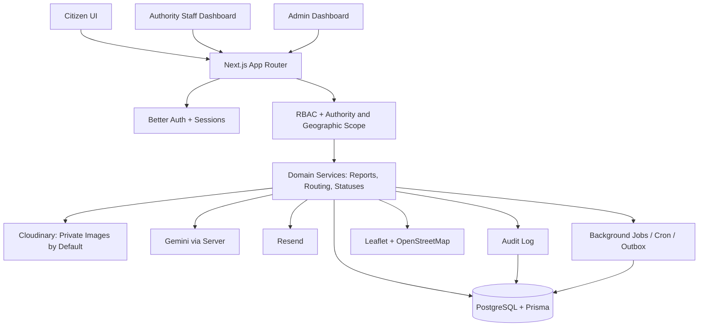
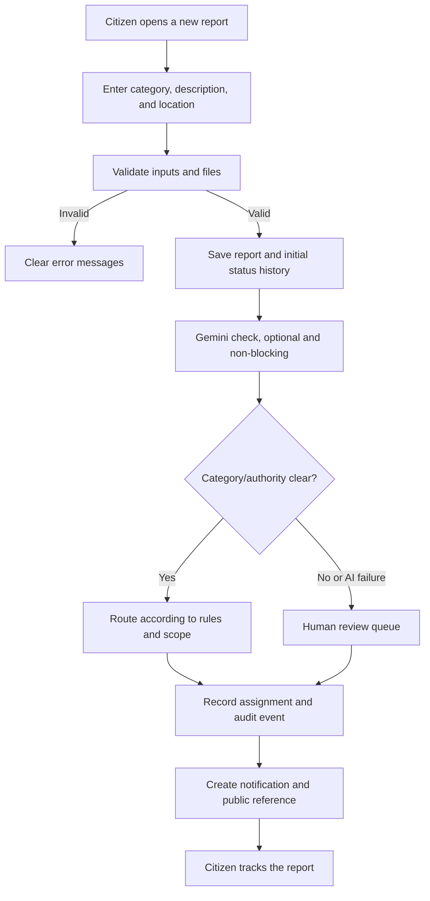
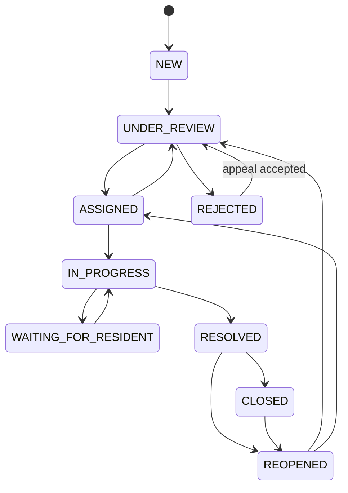
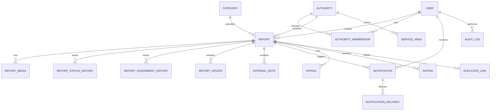

# Madinaty — Complete Project Blueprint

**Product name:** Madinaty  
**Purpose:** A single, executable reference document for a development team or coding agent. Inspect the current repository first, then implement in small, testable stages. Do not rewrite working components without a documented reason, and do not mark a feature complete without evidence or a passing test.

- Product: An Arabic-first platform for reporting and tracking public infrastructure and environmental issues.
- Initial scope: One city/governorate, designed to scale.
- Interface direction: Arabic, RTL, mobile-first.
- Release decision #100: Mandatory pre-production checklist. Do not release with unresolved critical or high-severity issues.

## 1. Version 1 scope

### Included
- Citizen, staff, and administrator accounts, with permissions constrained by role, authority, and geographic scope.
- Report creation with description, category, photos, location, and hybrid routing to the responsible authority.
- Initial image validation through Gemini, with human review when uncertain or when the service is unavailable.
- Status lifecycle, rejection, appeals, review requests, repair evidence, and closure.
- In-app and email notifications, activity history, and ratings.
- Maps, searchable lists, filters, and role-specific dashboards.
- Management of categories, authorities, routing rules, and operational settings.
- Error, performance, and cost monitoring; backups; tests; and deployment documentation.

### Out of scope for Version 1
- Native mobile app or PWA; English interface; internal support-ticket system.
- Citizen JSON/CSV export; a separate public authority directory; semantic search or advanced Arabic normalization.
- MFA, a separate idle-session expiration policy, and recurring citizen reminders.
- External government integrations that are unavailable or unconfirmed.

## 2. Approved technology stack

| Area | Technology |
|---|---|
| Application and API | Next.js App Router + TypeScript; no separate Express server in Version 1 |
| UI | React + Tailwind CSS + shared components |
| Data | PostgreSQL + Prisma + Prisma Migrate |
| Authentication | Better Auth |
| Input validation | Zod |
| Maps | Leaflet + OpenStreetMap |
| AI | Gemini, server-side only |
| Image storage | Cloudinary |
| Email | Resend |
| Deployment | Vercel + managed PostgreSQL such as Neon or a suitable alternative |
| Testing | Unit/integration tests + Playwright E2E |
| CI/CD | GitHub Actions + Vercel Preview |
| Monitoring | Sentry |
| Work management | GitHub Projects + Issues + Milestones |

Verify that current library versions are compatible before pinning them. Secrets and service keys must never be sent to the browser or use the `NEXT_PUBLIC_` prefix.

## 3. Roles and permissions

### Citizen
- Register, verify email, recover password, create reports, track their own reports, add information or appeal, request review/reopening, and rate a report after resolution.
- Cannot view other users’ data, internal notes, or private images, and cannot change a role or report status outside their permissions.

### Authority Staff
- Manage reports assigned to them or within their authorized authority and geographic scope.
- Update status, document work, request information, reject with a reason, and confirm category/priority/assignment changes when authorized.
- Cannot expand their own permissions or alter the audit log.

### Admin
- Manage authorities, staff, permissions, scopes, categories, routing rules, and settings; review ambiguous cases.
- Every sensitive administrative action must be recorded in the Audit Log.

### Authorization implementation requirements
- Apply RBAC with authority, geographic-scope, and action-level restrictions.
- Enforce authorization on the server in every Route Handler, Server Action, and sensitive query.
- Use centralized functions such as `requireUser`, `requireRole`, and `requireAuthorityScope`.
- Never trust `userId`, `role`, or `authorityId` supplied by the client.
- Disabling a staff account or revoking permissions must block access immediately, including existing sessions.
- Explicitly test IDOR and privilege escalation.

## 4. Report lifecycle and rules

### Statuses
`NEW → UNDER_REVIEW → ASSIGNED → IN_PROGRESS → RESOLVED → CLOSED`

Additional statuses and paths: `REJECTED` and `CLOSED_NO_RESPONSE`. Review and reopening requests must not erase prior history.

| Status | Meaning |
|---|---|
| `NEW` | Report received and saved |
| `UNDER_REVIEW` | Validation or review |
| `ASSIGNED` | Assigned to an authority |
| `IN_PROGRESS` | Work has started |
| `RESOLVED` | Repair or remediation documented |
| `CLOSED` | Closed after closure conditions are met |
| `CLOSED_NO_RESPONSE` | Appeal window expired without an appeal, after successful notification |
| `REJECTED` | Rejected with a clear reason |

### Mandatory rules
- Create an official transition matrix and reject every transition not allowed by the server.
- Perform sensitive status changes inside database transactions.
- Record the previous status, new status, actor, timestamp, and reason.
- Do not allow `RESOLVED` without a repair description and suitable evidence when available, or a documented reason why a photo is unavailable.
- The default citizen appeal window is **7 calendar days**, starting after successful resolution notification.
- An appeal submitted within the window pauses automatic closure and returns the report for review.
- Automatic transition to `CLOSED_NO_RESPONSE` is allowed only after the window expires, the required notification succeeds, and no appeal is open.
- A closed report can be submitted for reopening; do not erase its history.
- Rejection requires an understandable reason. The initial review-request window is 7 days from successful notification and must be configurable.
- Rejection reasons include unsupported category, outside the service area, insufficient information, or another authority’s responsibility.

## 5. Routing, priority, and SLA

- Store categories, authorities, areas, and routing rules in PostgreSQL; manage them from the admin dashboard without code changes.
- A routing rule specifies category, scope, proposed authority, priority, and activation status.
- Ambiguous or conflicting rules must go to administrative review.
- A text address or reverse geocoding result is not conclusive proof of jurisdiction.
- A report may be automatically rejected when clearly outside scope or in an unsupported category; ambiguous location must go to review.
- Suggest priority using explicit rules. Authorized staff must confirm important changes and record the reason.
- SLA starts when the report is created and is measured continuously in calendar time, including nights and holidays.
- Reassignment does not automatically reset SLA. Targets are indicators, not guarantees of resolution.
- The system may suggest an alternative authority, but authorized staff must confirm reassignment and record the reason and time.

## 6. Duplicate and conflicting reports

### Duplicate detection and merging
- Compare distance, category, time, description, and status; do not rely on location and category alone.
- Show similar reports to the user before submission.
- Automatic merging is the intended policy, but it must remain disabled in production until strict matching criteria and clear tests are approved.
- Preserve original report IDs, ownership information, and history, and link duplicates to a canonical report.
- Record the reason and time of a merge, and provide an admin action to reverse an incorrect merge while preserving the audit trail.
- Use manual review when uncertain or when information conflicts.

### Conflicting information
- Preserve every update, its timestamp, and its source.
- A citizen’s report must not change another report’s status without permission.
- “Latest update wins” must not apply to sensitive status changes or data the actor is not authorized to modify.
- Record old value, new value, actor, and reason.

## 7. Maps and location

- Use Leaflet and OpenStreetMap while respecting tile-provider terms and usage limits.
- Let users select a location on the map or enter it manually. GPS is optional and requires user permission.
- Store coordinates and address description when available, and validate geographic scope on the server.
- Do not make GPS mandatory for submission, and do not expose precise coordinates publicly by default.
- Load map data only for the visible area; use debouncing and marker clustering when needed.
- Protect map APIs like other system APIs, and design the map layer so the provider can be changed later.

## 8. Gemini and images

### Gemini
- Its role is initial validation that an image relates to a reportable public issue—not determining jurisdiction, the real-world location, cost, or final status.
- Use structured results: `VALID`, `INVALID`, or `UNCERTAIN`, with a short reason, optional trustworthy confidence score, and inspection timestamp/version.
- Call Gemini only from the server.
- `UNCERTAIN`, timeout, or service failure must result in saving the report and routing it to review, not automatic rejection.
- Do not publish a report publicly before approval.
- Set timeouts, retry limits, and idempotency; monitor cost and quotas.

### Files
- Accepted types: JPG, PNG, and WebP.
- Maximum 5 MB per image and 5 images per upload operation, including repair photos.
- Validate actual content type, not just extension; re-encode images when needed and remove sensitive EXIF metadata, including GPS.
- Upload through a secure flow, and store the storage key and metadata in the database.
- Images are private by default. Access requires server-side authorization or a short-lived signed URL.
- Never display or download an image without checking the user’s permissions.
- Image retention periods must be decided after legal and operational review. Log deletion operations without exposing sensitive content.

## 9. Accounts and security

- Use Better Auth for accounts and sessions. Version 1 supports email and password only, without MFA.
- Verify email using a single-use, expiring link, with limits on resending.
- Password recovery must use a secure, single-use, expiring link. Use generic messages that do not reveal whether an email address exists.
- Allow long passphrases, password managers, and paste; do not force periodic password changes without a reason.
- Apply rate limiting to authentication, reports, uploads, and Gemini.
- Use HTTPS, Zod, safe Prisma access, security headers, CSP, and CSRF protection where applicable.
- Never log passwords, session tokens, API keys, or unnecessary sensitive data.
- Admin and staff accounts face additional risk without MFA; enforce strong passwords and monitor activity.
- Version 1 has no separate idle-session expiry policy, but disabling staff or revoking permissions must immediately block access.
- Do not disable citizen accounts for inactivity. Retain work records according to policy.

## 10. Notifications and background jobs

- Send in-app and email notifications for creation, status changes, assignment, rejection, appeal, resolution, and closure as appropriate.
- Provide a notification center with read/unread state, a counter, filters, and secure links to reports.
- Use Resend for email with Arabic templates and SPF/DKIM configured.
- Store notifications in the database and use a unique event identifier to prevent duplicates.
- Send email through background jobs with exponential backoff and a maximum retry count.
- Use Cron for scheduled work such as checking expired appeal windows, plus a reliable job/retry mechanism.
- Jobs must be idempotent. Check current status and open appeals before closing.
- Email failure must not cancel report persistence, and closure conditions that depend on notification must not start until the required notification succeeds.
- Never rely on a user keeping a page open to run essential jobs.

## 11. Privacy, deletion, and public visibility

- Only approved reports may be public, and only with permitted fields such as category, area, status, and date.
- Do not expose reporter identity, internal notes, images, or precise coordinates by default.
- Do not rely on hiding UI elements or `robots.txt` to protect data.
- Provide clear Arabic privacy policy and terms of use explaining image use, location, and public display.
- GPS is optional; collect the minimum necessary data.
- The approved decision is to update the policy page and its last-updated date only. Version tracking of accepted policies is out of scope for Version 1. If law or a material change requires renewed consent, implement it following legal review.
- Citizens may delete their reports under the approved policy, but permitted states must be specified. Distinguish hiding a report from actual deletion, and do not delete necessary audit records without legal assessment.
- Account-deletion or anonymization requests must follow identity verification and legal obligations.
- Retention periods for each data and image type must be approved after legal review; do not invent final periods.
- Aggregate usage analytics where possible, without names, images, report descriptions, or precise coordinates.

## 12. Search, user experience, and performance

- Use a unique, non-sequential public reference such as `MD-7K9M-2P4R`, separate from the internal ID; it is not a security mechanism.
- Support search by reference or description, plus status, category, priority, date, and area filters. Use pagination and suitable indexes.
- Use standard PostgreSQL search; advanced Arabic normalization and semantic search are out of scope for Version 1.
- Do not save report drafts locally. Form data remains only while the page is open. Show a leave-page warning where possible.
- Use an idempotency key after submission starts to prevent duplicates, and do not show success before server confirmation.
- Provide clear Arabic loading, success, and error states; prevent double submission and do not show unmeasurable progress.
- Target WCAG 2.2 AA: keyboard support, screen-reader support, contrast, visible focus, clear labels, and understandable errors.
- Do not load every report onto the map. Use pagination, indexes, and caching only for public data.
- Heavy processing and analytics run in the background. Compress images, minimize Gemini calls, and monitor costs.
- Do not send private data to external analytics tools.

## 13. Concurrency and data integrity

- Use optimistic concurrency control via `version` or an equivalent mechanism.
- On conflicting edits, reject the stale version and require the user to refresh.
- Validate status and permissions inside the database transaction before transitioning.
- Use unique constraints and appropriate mechanisms to prevent duplicate reports, notifications, ratings, and jobs.
- Preserve previous values for sensitive changes and use row locks only when needed.

## 14. Dashboards

- **Citizen:** Their reports, details, timeline, notifications, appeal/review/reopening, and rating when eligible.
- **Staff:** Reports in their scope, filters, assignment, status updates, repair documentation, appeal review, and SLA.
- **Admin:** Authority, category, scope, routing-rule, settings, and staff management; audit log; analytics by area, category, priority, and authority.
- Every dashboard must call secure APIs that enforce permissions on the server. Hiding UI elements is not sufficient.

## 15. Environments, migrations, and deployment

- Separate Development, Preview, and Production, including databases and test services.
- Use local `.env.local`, exclude it from Git, and configure separate Vercel variables for each environment.
- Validate environment variables at startup without exposing secret values in logs.
- Keep Prisma migrations in Git. Use `prisma migrate dev` for development and `prisma migrate deploy` for deployment; never use `prisma db push` in production.
- The approved decision allows a simple direct production database update, but migration testing, backups, and a recovery plan remain mandatory.
- For risky changes, use an expand/compatibility strategy where needed. Rolling back application code does not automatically reverse database changes.
- GitHub Actions runs ESLint, TypeScript, unit/integration tests, Prisma validation, build, and environment-appropriate E2E/security checks.
- Use PR reviews and Vercel Preview; block merges when required checks fail.

## 16. Backups, monitoring, and recovery

- Automate database backups and periodically perform and document restoration tests.
- Initial proposed targets: RTO within 24 hours and RPO no more than 24 hours. Approve these based on service needs and cost.
- Use Sentry for error and performance monitoring, structured logs, and alerts for API, jobs, Gemini, and email failures.
- Do not log secrets, passwords, or unnecessary sensitive details.
- If Gemini fails, save the report and route it to review.
- If email fails, preserve the report and retry.
- If storage or the database fails, do not report false success; allow safe retries.
- If a public status page is enabled, it must show only factual information about the platform and core services.
- Monitor service usage and costs; alerts do not guarantee a spending cap.

## 17. Documentation and work management

Suggested documentation files:
- `README.md`: project overview and local setup.
- `docs/architecture.md`: architecture.
- `docs/report-lifecycle.md`: statuses and transitions.
- `docs/permissions.md`: roles and scopes.
- `docs/privacy-and-retention.md`: privacy, deletion, and retention.
- `docs/api.md`: API contracts and errors.
- `docs/deployment.md`: deployment, migrations, and recovery.
- `.env.example`: variable names only, no secrets.

Use GitHub Projects, Issues, and Milestones, with columns `Backlog → Ready → In Progress → In Review → Done`. Every issue must include goal, scope, dependencies, acceptance criteria, and tests. Link PRs to issues and update documentation for significant changes. Use Semantic Versioning, a CHANGELOG, and Git tags.

## 18. Implementation phases

### Phase 0 — Discover the current state and establish working rules

**Tasks**
1. Inspect the repository, branches, package manager, tests, pages, and APIs.
2. Review the Prisma schema, existing migrations, and environment files without exposing secrets.
3. List what exists, is missing, or is broken. Do not rebuild healthy components.
4. Approve the authorization matrix and status-transition rules.
5. Resolve report deletion, merging, conflict, and data-retention rules.

**Acceptance:** A prioritized gap report and clear, non-conflicting business rules.

### Phase 1 — Foundation and authentication
- Configure environments, Prisma migrations, and a seed script.
- Configure Better Auth, email verification, and password recovery.
- Implement RBAC and authority/geographic scope.
- Set up the basic Audit Log.

**Acceptance:** Registration, login, authorization, and unauthorized-access prevention tests pass.

### Phase 2 — Report lifecycle
- Create reports with public references, category, location, and description.
- Implement hybrid routing, status transitions, and rejection.
- Implement appeals, review requests, and reopening.
- Implement repair evidence, closure, timeline, and ratings.
- Implement deletion, merging, and concurrency rules.

**Acceptance:** The complete report lifecycle works, with tests for permitted and prohibited transitions.

### Phase 3 — Images, maps, and Gemini
- Secure Cloudinary, enforce file limits, and remove EXIF metadata.
- Implement Leaflet, location selection, and geographic-scope validation.
- Integrate Gemini, structured results, and failure handling.
- Prevent publication of unapproved reports.

**Acceptance:** Tests cover invalid files, valid/irrelevant/ambiguous images, service failure, and timeouts.

### Phase 4 — Notifications and jobs
- Implement notification center and Arabic email through Resend.
- Prevent duplicates and implement retries.
- Implement Cron-based closure after the appeal window.
- Monitor stuck jobs and alert on them.

**Acceptance:** Email failure does not lose reports; reports with open appeals are never closed automatically; side effects are not duplicated.

### Phase 5 — Interfaces and dashboards
- Build citizen, staff, and admin pages.
- Build authority, category, and routing-rule management.
- Implement search, filters, and a restricted public map.
- Implement SLA, analytics, and public SEO.
- Implement RTL, responsive layouts, and accessibility.

**Acceptance:** Every role is tested on mobile and desktop without exposing data outside its permissions.

### Phase 6 — Readiness and launch
- Run unit, integration, and Playwright E2E tests.
- Test security, authorization, uploads, concurrency, and duplicate prevention.
- Test backup restoration and production migrations.
- Test Gemini, email, and storage failures.
- Review privacy, retention, and deletion.
- Configure Sentry, alerts, costs, domain, email, and production environment variables.

**Acceptance:** No unresolved critical or high-severity issues; every launch checklist item has documented evidence or a test result.

## 19. Mandatory launch checklist — Decision #100

### Functionality
- [ ] Registration, login, verification, and password recovery work.
- [ ] Report creation, tracking, and routing work.
- [ ] Status transitions, rejection, appeals, and reopening are tested.
- [ ] Repair documentation and automatic closure work under the correct conditions.
- [ ] Deletion, merging, and conflict handling preserve history and permissions.
- [ ] Notifications, ratings, and dashboards work.

### Security and privacy
- [ ] Role, scope, and IDOR tests pass.
- [ ] A private image/report cannot be accessed by changing its identifier.
- [ ] No secrets exist in Git, client code, or logs.
- [ ] Image content-type and size validation are enabled.
- [ ] Public visibility policy is enforced on the server.
- [ ] Rate limiting and protection for authentication/upload endpoints are enabled.
- [ ] Error messages do not reveal internal details.

### Data and operations
- [ ] Migrations have been tested in a non-production environment.
- [ ] A recent backup exists.
- [ ] Backup restoration has been tested and documented.
- [ ] Background jobs, Cron, and idempotency have been tested.
- [ ] Rollback and recovery plans are documented.
- [ ] Production environment variables, domain, email, and services are correct.

### Failures and monitoring
- [ ] Gemini failure neither loses the report nor automatically rejects it.
- [ ] Email failure does not cancel report persistence.
- [ ] Storage failure does not produce false success.
- [ ] Sentry, logs, and alerts work without recording secrets.
- [ ] Cost and quota monitoring is enabled.
- [ ] If present, the public status page reports actual information.

### User experience and policies
- [ ] Responsive RTL is tested on mobile.
- [ ] Basic accessibility tests pass.
- [ ] Arabic privacy policy, terms, and help are available.
- [ ] Emergency guidance is clear; the platform does not imply that it is an emergency service.
- [ ] Retention and deletion periods have been reviewed by the appropriate parties.
- [ ] Checklist results are documented and critical/high-severity issues are resolved.

**Do not launch if any critical or high-severity item fails.** Any non-critical exception must be documented with an owner, remediation plan, and explicit risk acceptance.

## 20. First ten implementation issues

1. `Audit current repository` — Inspect the repository and produce a gap report.
2. `Finalize business rules` — Document statuses, appeals, deletion, merging, and conflicts.
3. `Define authorization matrix` — Define actions and scopes for each role.
4. `Review Prisma schema and migrations` — Review the schema and migrations.
5. `Configure environments and CI` — Separate environments and configure checks.
6. `Implement/verify authentication` — Complete Better Auth, email verification, and recovery.
7. `Implement server-side permissions` — Implement and test centralized authorization.
8. `Implement report lifecycle` — Implement reports, statuses, appeals, and history.
9. `Secure image pipeline and Gemini fallback` — Secure image handling and Gemini failure paths.
10. `Build release-readiness tests` — Convert the launch checklist into documented tests.

## 21. Rules for the coding agent

1. Inspect the code before editing and present a plan for the current phase.
2. Implement the smallest complete, testable change.
3. Do not replace architecture or libraries without a documented reason.
4. Do not delete data or make production changes without explicit approval and a recovery plan.
5. Never print secrets or use real user data in tests.
6. Never rely on the UI to protect data.
7. A successful build alone is not proof that a feature works.
8. Run tests after each phase and report results and changed files.
9. On failure, show the error and reproduction steps rather than hiding it.
10. Do not claim a feature is complete without code evidence or a passing test.
11. Do not implement every decision at once; finish and review one phase before moving to the next.
12. Document any new decision that contradicts this plan and its impact on earlier decisions.

## 22. Decisions to approve before production

Do not guess the following:
- City and geographic boundaries.
- Actual category and authority lists and routing rules.
- SLA targets for each priority.
- Retention periods for each data and image type.
- States in which a report may be deleted after review/work has begun.
- Automatic merge criteria and merge-reversal procedure.
- Definition of high priority and emergency guidance.
- Final rate limits.
- Acceptable RTO/RPO targets.
- Map, email, and storage providers and their costs.
- Legal review of privacy, terms, retention, and deletion.

## 23. Definition of Version 1 complete

Madinaty is ready when a citizen can create and track a report through closure; an authority can process it within its permissions; appeals, notifications, and automatic closure work under the defined conditions; Gemini or email failure does not lose a report; unauthorized data cannot be accessed; tested backups and audit logs exist; required tests pass; the Arabic interface works on mobile and desktop; policies are documented and reviewed; and the launch checklist has no unresolved critical or high-severity issues.

---

**Next step:** Execute Phase 0 only: inspect the current repository, compare it with this plan, and produce a prioritized gap list. After approval, start Phase 1 while preserving components that already work.

---

# Appendix A — System, Database, and API Design

## A1. High-level architecture



**Architecture principles:** No separate Express server in Version 1. Business logic and authorization checks run on the server. Do not call Gemini or email services inside long-running database transactions. Failure of an external service must not turn a partially failed operation into a false success.

## A2. Report creation flow



## A3. Status diagram



This is an illustrative diagram. The final transition matrix and the appeal/automatic-closure rules are authoritative and must be tested for every allowed and prohibited transition.

## A4. Entity relationship diagram (ERD)



## A5. Proposed database design

The following names form a logical model for Prisma/PostgreSQL; they do not assert that these tables already exist. Adapt fields required by the selected Better Auth version according to its current documentation, then create reviewable migrations.

### `User`
- `id` — UUID/CUID primary key.
- `name`, `email` (unique after normalization), `emailVerifiedAt`, optional `phone`.
- `status`: `ACTIVE | SUSPENDED | PENDING`.
- `preferredLocale`, `createdAt`, `updatedAt`, optional `deletedAt`.
- Session and account fields required by Better Auth.
- Represent roles/memberships through explicit relations instead of trusting a role supplied by the browser.

### `Authority`
- `id`, `name`, unique `slug`, `description`, `contactEmail`, `isActive`, `createdAt`, `updatedAt`.

### `AuthorityMembership`
- `id`, `userId` FK, `authorityId` FK.
- `membershipRole`: `VIEWER | TRIAGE | OPERATOR | AUTHORITY_ADMIN`.
- `isActive`, `createdAt`, `updatedAt`.
- Unique constraint on `(userId, authorityId)`.

### `Category`
- `id`, unique `key`, `domain`, `labelAr`, `labelEn`, `descriptionAr`, `descriptionEn`.
- Optional `defaultAuthorityId` FK, `isActive`, `createdAt`, `updatedAt`.
- Use the stable category keys defined in the category section. Do not change keys used by reports without a migration.

### `Report`
- `id`, unique non-sequential `publicReference`, `createdById` FK.
- `categoryId` FK, optional `authorityId` FK before routing, optional `assignedToId` FK.
- `title`, `description`, `status`, `priority`.
- `latitude`, `longitude` at suitable precision, `addressText`, `locationPrecision`.
- `visibility`: `PRIVATE | PUBLIC_PENDING | PUBLIC`.
- Optional `aiValidationResult`, `aiConfidence`, `aiReviewState`, `routingRuleVersion`.
- Optional `canonicalReportId` if merging is implemented; points to the canonical report.
- `version`, `createdAt`, `updatedAt`, `submittedAt`, `resolvedAt`, `closedAt`.
- Suggested indexes: `(createdById, createdAt DESC)`, `(authorityId, status, createdAt DESC)`, `(status, createdAt DESC)`, `(categoryId, createdAt DESC)`, and a geographic index if PostGIS is used.

### `ReportMedia`
- `id`, `reportId` FK, `storageProvider`, `storageKey`, `mimeType`, `sizeBytes`.
- `width`, `height`, `uploadedById`, `moderationState`, optional `sha256`, `createdAt`.
- Do not store a permanent public URL for a private image; use storage keys and short-lived signed URLs.

### `ReportStatusHistory`
- `id`, `reportId` FK, `fromStatus`, `toStatus`, `reason`.
- Nullable `changedById` for automated jobs, `actorType`, `createdAt`, limited `metadata`.
- This history must not be edited to conceal previous events.

### `ReportAssignmentHistory`
- `id`, `reportId` FK, `fromAuthorityId`, `toAuthorityId`, `fromAssigneeId`, `toAssigneeId`.
- `reason`, `changedById`, `routingRuleVersion`, `createdAt`.

### `ReportUpdate` and `InternalNote`
- `ReportUpdate`: `id`, `reportId`, `authorId`, `body`, `createdAt`, `editedAt`, plus a controlled visibility field if a unified table is used.
- `InternalNote`: `id`, `reportId`, `authorId`, `body`, `createdAt`, `editedAt`.
- Prefer separating internal notes from public updates to reduce leakage risk.

### `Notification` and `NotificationDelivery`
- `Notification`: `id`, `userId`, optional `reportId`, `type`, `title`, `body`, `readAt`, `createdAt`.
- `NotificationDelivery`: `id`, `notificationId`, `channel`, `status`, `attemptCount`, sanitized `lastError`, `sentAt`, `createdAt`, `updatedAt`.
- Use an idempotency key to prevent sending the same notification more than once.

### `Appeal`
- `id`, `reportId`, `createdById`, `reason`, `status`, `reviewedById`, private `reviewNote`.
- `createdAt`, `updatedAt`, `resolvedAt`.
- Never automatically close a report with an open appeal.

### `Rating`
- `id`, `reportId`, `createdById`, `score`, `comment`, `createdAt`.
- Unique constraint on `(reportId, createdById)` if one rating per citizen/report is the final decision.

### `DuplicateLink`
- `id`, `sourceReportId`, `targetReportId`, `relation`, `confidence`, `createdById`, `createdAt`.
- Prevent self-links and cycles in canonical-report chains; record merges and reversals.

### `AuditLog`
- `id`, nullable `actorUserId`, `actorType`, `action`, `entityType`, `entityId`, `requestId`, `metadata`, `createdAt`.
- Do not store passwords, session tokens, images, or unnecessary personal data. Restrict write access and do not allow ordinary users to edit it.

### `ServiceArea` and `RoutingRule`
- `ServiceArea`: `id`, `authorityId`, `name`, `geometry` (PostGIS or a documented alternative), `isActive`, timestamps.
- `RoutingRule`: `id`, `categoryId`, optional `serviceAreaId`, `authorityId`, `priority`, `isActive`, `version`, timestamps.
- Without reliable geographic data, use an explicit manual scope or review queue; do not infer definitive jurisdiction from address text alone.

### `OutboxEvent` (recommended)
- `id`, `eventType`, `aggregateId`, `payload`, `status`, `attemptCount`, `availableAt`, `createdAt`, `updatedAt`.
- Supports retryable external email/job processing without duplicate side effects.

### General data constraints
- All relations must use foreign keys and explicit `onDelete` policies.
- Store timestamps in UTC and display them in the user’s timezone.
- Validate latitude and longitude bounds on the server.
- Do not use cascading deletion that erases audit history or report history without a documented decision.
- Test migrations against a clean database and a test copy resembling production.

## A6. Logical API map

| Operation | Proposed path | Permissions / notes |
|---|---|---|
| Create report | `POST /api/reports` | Authenticated citizen; validate data and attachments; idempotency |
| My reports | `GET /api/reports/mine` | Returns only the current user’s reports |
| Report details | `GET /api/reports/:id` | Verify ownership, authority scope, or public visibility |
| Update permitted fields | `PATCH /api/reports/:id` | Only citizen-editable fields and statuses |
| Upload image | `POST /api/reports/:id/media` | Verify report access, file type, and size |
| Authority queue | `GET /api/authority/reports` | Authority scope enforced on the server |
| Assign/reassign | `POST /api/reports/:id/assign` | Appropriate permission, explicit confirmation, reason, history |
| Change status | `POST /api/reports/:id/status` | Transition matrix, reason, history, and audit |
| Public update | `POST /api/reports/:id/updates` | Visible to citizen according to policy |
| Internal note | `POST /api/reports/:id/internal-notes` | Authorized staff only |
| Appeal | `POST /api/reports/:id/appeals` | According to status and deadline |
| Manage authorities/categories | `/api/admin/...` | Admin only, with Audit Log |

Every endpoint must validate session, role, scope, and input. Do not send ORM objects directly to the client; use separate DTOs for public, citizen, staff, and admin views. Use pagination, stable sorting, request limits, and error messages that do not reveal internal details.

## A7. Proposed repository structure

```text
madinaty/
├── app/
│   ├── (public)/
│   ├── (auth)/
│   ├── (citizen)/
│   ├── (authority)/
│   ├── (admin)/
│   ├── api/
│   ├── layout.tsx
│   └── globals.css
├── components/       # UI/forms/reports/maps/layout
├── features/         # auth/reports/routing/notifications/admin
├── lib/              # auth/db/validation/security/integrations
├── prisma/           # schema.prisma + migrations
├── emails/
├── tests/            # unit/integration/e2e
├── docs/             # architecture, API, lifecycle, deployment
├── public/
├── .github/workflows/
├── .env.example
├── .gitignore
├── README.md
└── package.json
```

## A8. Environment variables

```dotenv
DATABASE_URL=
BETTER_AUTH_SECRET=
BETTER_AUTH_URL=http://localhost:3000
GEMINI_API_KEY=
CLOUDINARY_CLOUD_NAME=
CLOUDINARY_API_KEY=
CLOUDINARY_API_SECRET=
RESEND_API_KEY=
EMAIL_FROM=
NEXT_PUBLIC_APP_URL=http://localhost:3000
NEXT_PUBLIC_MAP_TILE_URL=
SENTRY_DSN=
```

These are suggested names; verify them against the selected versions’ documentation. Never put a secret under `NEXT_PUBLIC_` or commit `.env` files to Git.

## A9. Additional technical acceptance criteria

- [ ] A citizen cannot read another citizen’s private report by changing its identifier.
- [ ] Staff cannot read another authority’s reports without explicit permission.
- [ ] Every status change records old/new status, actor, time, and reason.
- [ ] Gemini failure does not prevent report persistence or automatically reject the report.
- [ ] Email failure does not cancel the report; retries do not duplicate notifications.
- [ ] Private images are not exposed through permanent public URLs.
- [ ] A report is not automatically closed while an appeal is open or before notification/window requirements are met.
- [ ] A backup can be restored and the process has been tested.
- [ ] Lint, type-check, tests, production build, and critical-path checks pass.

---

# Appendix B — Executive Summary: Name and Scope

- **Product name:** Madinaty
- **Technical/English name:** Madinaty
- **Repository:** `https://github.com/demianeid/madinaty`
- **Project status:** New project; the repository is reported to be empty, so initialize it rather than assuming an existing application.
- **Initial goal:** An Arabic RTL web application for reporting public issues and tracking them through the responsible authority.
- **First implementation step:** Create a Next.js + TypeScript application, configure CI and environments, then database, authentication, and authorization, followed by a complete report workflow before adding advanced AI and email integrations.

**Warning:** This blueprint describes what should be built; it is not evidence that any feature has already been implemented. Legal and operational decisions requiring approval from a responsible party must be resolved before public launch.
