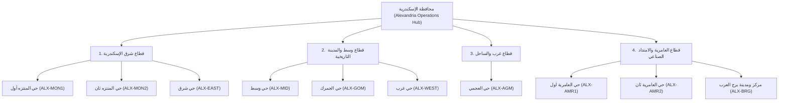

# المخطط التنفيذي الشامل: تقسيم محافظة الإسكندرية (Madinaty Alexandria Master Plan)
**وثيقة مرجعية تشغيلية - التحول الرقمي وإدارة البلاغات الميدانية في محافظة الإسكندرية**
*تاريخ الإصدار: نوفمبر 2026 | الإصدار: 1.0.0*

---

## 1. المقدمة والرؤية الاستراتيجية

يهدف هذا المخطط إلى إعادة هيكلة وتوطين منصة **"مدينتي"** كمنظومة وطنية متكاملة لإدارة الطوارئ والبلاغات البلدية في **محافظة الإسكندرية**، بمحاكاة دقيقة للواقع الجغرافي والإداري على الأرض، وبالتكامل مع الهيئات وشركات المرافق الحقيقية المسؤولة عن تشغيل وصيانة المدينة الساحلية.

تم بناء هذه الخطة بناءً على دراسة تفصيلية للواقع الميداني، والتحديات المناخية (موسم النوّات الشتوية والأمطار الغزيرة)، والطبيعة الطولية للمدينة الممتدة لأكثر من 70 كم على ساحل البحر الأبيض المتوسط.

---

## 2. الدراسة الميدانية لواقع محافظة الإسكندرية

### 2.1 الخصائص الجغرافية والشريانية
* **الامتداد الساحلي:** تمتد المحافظة من خليج أبي قير شرقاً (خط طول `30.08° E`) حتى سيدي كرير وبداية الساحل الشمالي ومدينة برج العرب غرباً (خط طول `29.50° E`).
* **الامتداد العرضي (الجنوبي):** من شاطئ البحر شمالاً (`31.35° N`) حتى عمق بحيرة مريوط والمنطقة الصناعية ببرج العرب ومطار برج العرب الدولي جنوباً (`30.80° N`).
* **شرايين الحركة الرئيسية:**
  1. **طريق الجيش (الكورنيش):** يمتد لنحو 16 كم من رأس التين وحتى المنتزه؛ يمثل شريان الجذب السياحي الأول وبؤرة تصريف مياه البحر والرياح.
  2. **طريق الحرية (شارع أبي قير / فؤاد):** الشريان الطولي الداخلي الأهم الذي يربط محطة مصر شرقاً بالمنتزه وأبي قير.
  3. **محور المحمودية (شريان الأمل):** المحور المروري السريع البديل المحاذي لترعة المحمودية، يربط غرب ووسط وشرق المحافظة.
  4. **طريق الإسكندرية - مطروح الساحلي:** شريان الربط الغربي لأحياء الدخيلة، العجمي، والساحل.
  5. **الطريق الدائري السكندري / الصحراوي:** حزام الشحن الثقيل وحركة النقل بين الإسكندرية والقاهرة والمناطق الصناعية.

### 2.2 التحديات البلدية الموسمية والحرجة على أرض الواقع
1. **نوّات الشتاء وأزمة تصريف مياه الأمطار:**
   - الإسكندرية تتعرض سنوياً لنحو 18 نوّة رئيسية (المكنسة، قاسم، الفيضة الصغرى، الغطاس، الكرم).
   - التحدي الميداني الأكبر: تراكم المياه في الأنفاق الحيوية (نفق المندرة، نفق 45، نفق كليوباترا، نفق سيدي جابر، نفق محرم بك) وانسداد "الشنايش" ومطابق الصرف بفعل الرمال والأتربة.
2. **النفايات والمخلفات الصلبة:**
   - كثافة سكانية ضخمة تناهز 5.5 مليون نسمة شتاءً وتتجاوز 8 ملايين صيفاً.
   - مسندة لشركة **نهضة مصر للخدمات البيئية الحديثة**، وتتطلب مراقبة تفريغ الحاويات في المواعيد المحددة ونظافة الشوارع والشواطئ ومحطات الترحيل الوسيطة (محطة محرم بك، محطة الزياتين، محطة أم زغيو).
3. **تآكل البنية التحتية والشبكات القديمة:**
   - وسط المدينة والأحياء القديمة (الجمرك، كرموز، اللبان) تحتوي على شبكات مياه شرب وصرف يعود بعضها لأكثر من 80 عاماً، مما يسبب كسوراً مفاجئة في خطوط المياه وهبوطات أسفلتية.
4. **تآكل أعمدة الإنارة بفعل الملوحة البحرية:**
   - الرطوبة المشبعة بالأملاح على طول الكورنيش تسبب صدأ الأعمدة وتلف الكابلات الأرضية وتعرية الأسلاك، مما يتطلب استجابة فورية من شركة الكهرباء لتفادي الصعق.

---

## 3. التقسيم القطاعي والمناطقي المعتمد (10 أحياء + مركز)

تم تقسيم المحافظة إلى **4 قطاعات عملياتية كبرى (Macro Sectors)** تضم **10 أحياء رسمية ومركز ومدينة واحدة**:



### جدول تفاصيل الأحياء والنطاقات الجغرافية (`ServiceArea`):

| كود الحي | اسم الحي / المنطقة | نطاق الإحداثيات التقريبي (Center / Box) | أبرز الشياخات والمربعات الميدانية | طبيعة البلاغات الغالبة |
| :--- | :--- | :--- | :--- | :--- |
| **`ALX-MON1`** | **حي المنتزه أول** | `Lat: 31.258, Lng: 30.002` | سيدي بشر قبلي وبحري، ميامي، خورشيد، شارع جمال عبد الناصر، مصطفى كامل | قمامة، صرف صحي، إنارة، إشغالات |
| **`ALX-MON2`** | **حي المنتزه ثان** | `Lat: 31.305, Lng: 30.075` | المعمورة، أبو قير، طوسون، المندرة، العصافرة، الكليات البحرية | تجمعات أمطار ونوّات، صرف صحي، شواطئ |
| **`ALX-EAST`** | **حي شرق** | `Lat: 31.221, Lng: 29.953` | سموحة، سيدي جابر، كليوباترا، لوران، سان ستيفانو، فليمنج، جناكليس | هبوطات طرق، إشارات مرور، إنارة، مياه |
| **`ALX-MID`** | **حي وسط** | `Lat: 31.196, Lng: 29.914` | محرم بك، الشاطبي، الإبراهيمية، الأزاريطة، كوم الدكة، كفر عبده | عقارات آيلة للسقوط، كسور مياه، نظافة |
| **`ALX-GOM`** | **حي الجمرك** | `Lat: 31.205, Lng: 29.882` | بحري، رأس التين، الأنفوشي، اللبان، المنشية القديمة، سوق الميدان | صرف صحي، مباني تاريخية، إنارة الكورنيش |
| **`ALX-WEST`** | **حي غرب** | `Lat: 31.173, Lng: 29.871` | مينا البصل، كرموز، الورديان، القباري، منطقة الميناء | طرق شاحنات، تسريبات مياه وصرف، ردش |
| **`ALX-AGM`** | **حي العجمي** | `Lat: 31.115, Lng: 29.762` | البيطاش، الهانوفيل، الدخيلة، أبو يوسف، سيدي كرير، الكيلو 21 | مياه جوفية، صرف صحي، مخلفات بناء |
| **`ALX-AMR1`** | **حي العامرية أول** | `Lat: 31.025, Lng: 29.794` | مرغم، عبد القادر، العامرية البلد، ترعة مريوط | طرق صحراوية، إنارة، مخلفات مصانع |
| **`ALX-AMR2`** | **حي العامرية ثان** | `Lat: 30.952, Lng: 29.728` | كينج مريوط، الهوارية، الناصرية، مريوط | إنارة طرق، تعديات، تسريبات مياه عكرة |
| **`ALX-BRG`** | **مركز ومدينة برج العرب** | `Lat: 30.916, Lng: 29.548` | برج العرب القديمة، بهيج، أبو صير، قرى الساحل | صيانة شبكات، طرق زراعية وصحراوية |

---

## 4. الهيئات والشركات الخدمية الحقيقية على أرض الواقع (Authorities)

تم اعتماد **6 جهات ومؤسسات مسؤولة فعلياً على الأرض في الإسكندرية** داخل جدول `Authority`:

```
┌────────────────────────────────────────────────────────────────────────┐
│                   الهيئات والشركات الخدمية بالإسكندرية                 │
├────────────────────────────────┬───────────────────────────────────────┤
│ 1. شركة الصرف الصحي بالإسكندرية│ المسؤول الأول عن الشنايش ومطابق الصرف │
│    (ASDCO - الخط الساخن 175)   │ وطوارئ النوّات الشتوية                │
├────────────────────────────────┼───────────────────────────────────────┤
│ 2. شركة مياه الشرب بالإسكندرية │ معالجة كسور خطوط الشرب، التسريبات     │
│    (AWCO - الخط الساخن 125)    │ الأرضية، وضغط وجودة المياه           │
├────────────────────────────────┼───────────────────────────────────────┤
│ 3. شركة نهضة مصر للخدمات       │ الشركة المنوط بها إدارة قطاع القمامة   │
│    البيئية والنظافة            │ وتفريغ الحاويات ونظافة الشوارع        │
├────────────────────────────────┼───────────────────────────────────────┤
│ 4. شركة الإسكندرية لتوزيع      │ صيانة أعمدة الإنارة العامة والكابلات  │
│    الكهرباء (الخط الساخن 121)  │ وتأمين المهمات الكهربائية من الأمطار  │
├────────────────────────────────┼───────────────────────────────────────┤
│ 5. مديرية الطرق والنقل         │ صيانة الأسفلت، معالجة الحفر الوعائية  │
│    بمحافظة الإسكندرية          │ والأرصفة والمطبات العشوائية            │
├────────────────────────────────┼───────────────────────────────────────┤
│ 6. الإدارة المركزية للسياحة    │ مراقبة طريق الكورنيش، الشواطئ العامة  │
│    والمصايف بالإسكندرية        │ وإشغالات الممشى الساحلي                │
└────────────────────────────────┴───────────────────────────────────────┘
```

---

## 5. مصفوفة التوجيه الذكي التلقائي (Smart Routing Matrix)

عند قيام المواطن برفع البلاغ مع الصورة والإحداثيات، يقوم محرك الذكاء الاصطناعي (Gemini Vision) بتحديد التصنيف وتوجيه البلاغ تلقائياً للهيئة المختصة والحي المعني:

```
[بلاغ المواطن] ──► [تحليل Gemini] ──► [تحديد التصنيف والحي] ──► [التوجيه الآلي]
```

| التصنيف (`Category Key`) | اسم التصنيف في المنصة | الهيئة المسؤولة التلقائية (`Default Authority`) | مسار التحقق الميداني والـ SLA |
| :--- | :--- | :--- | :--- |
| `sewage-flooding` | **طفح الصرف الصحي وتجمعات الأمطار** | **شركة الصرف الصحي بالإسكندرية (ASDCO)** | استجابة فورية (SLA: 4 ساعات) بفرقة بدالات ومعدات شفط |
| `water-pipeline-burst` | **كسور خطوط مياه الشرب والتسريبات** | **شركة مياه الشرب بالإسكندرية (AWCO)** | استجابة عاجلة (SLA: 6 ساعات) لعزل الخط ومنع هدر المياه |
| `waste-accumulation` | **تراكم القمامة وتلف حاويات النفايات** | **شركة نهضة مصر للخدمات البيئية** | رفع المخلفات وتطهير الموقع (SLA: 12 ساعة) |
| `street-lighting-faults` | **أعطال إنارة الشوارع والأسلاك المكشوفة**| **شركة كهرباء الإسكندرية (AEDC)** | استجابة أمن وسلامة عاجلة (SLA: 8 ساعات) |
| `pavement-road-hazards` | **حفر الطرق والهبوطات الأسفلتية** | **مديرية الطرق والنقل بالإسكندرية** | معاينة وردم وسفلتة الموقع (SLA: 48 ساعة) |
| `coastal-corniche-issues`| **إشغالات وتلفيات الكورنيش والشواطئ** | **الإدارة المركزية للسياحة والمصايف** | ضبط وإزالة الإشغالات ومراجعة الشاطئ (SLA: 24 ساعة) |

---

## 6. خطة التطبيق الفنية في الكود وقاعدة البيانات

### المرحلة 1: تحديث ملفات التأسيس (`prisma/seed.ts`)
- استبدال البيانات العامة ببيانات الإسكندرية الحقيقية (الهيئات الست، الأحياء العشرة، والتصنيفات الدقيقة).
- إنشاء حسابات افتراضية لطاقم العمليات (`STAFF`) لكل هيئة (مثل: `ops.drainage@alex.gov.eg`، `ops.water@alex.gov.eg`، إلخ).

### المرحلة 2: ضبط الإحداثيات ومركز الخريطة
- تحديث `DEFAULT_CENTER` في الخريطة (`field-map.tsx` و `leaflet-map.tsx`) ليكون في قلب الإسكندرية (`Lat: 31.2001, Lng: 29.9187` - محيط سيدي جابر / سموحة).
- ضبط حدود النطاق الجغرافي المعتمد في `lib/reports/bounds.ts`:
  - `minLat: 30.80`, `maxLat: 31.38`
  - `minLng: 29.40`, `maxLng: 30.35`

### المرحلة 3: تصفية لوحة التحكم حسب القطاع والحي
- إضافة خيار فلترة متقدم في لوحة التحكم (`OpsReportsTable` و `FieldMap`) يتيح للمشرف استعراض بلاغات حي معين (مثلاً: "عرض بلاغات حي المنتزه أول فقط").

---

*تم إعداد هذه الوثيقة لتكون المرجع التنفيذي المباشر لكافة عمليات التطوير وتهيئة البيانات الخاصة بمحافظة الإسكندرية.*
