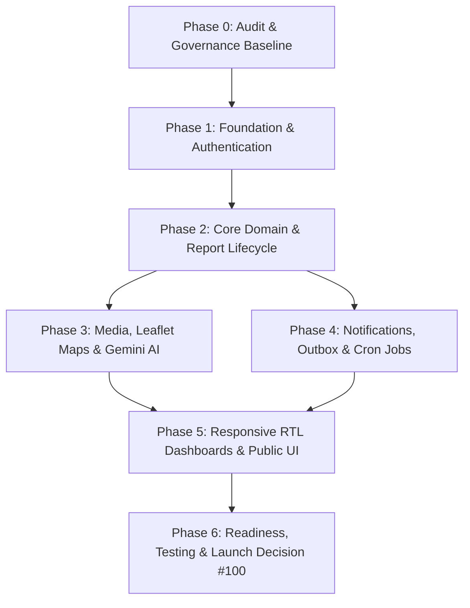

# Madinaty — Implementation Backlog & Work Sequencing

- **Status:** Approved Baseline (Post-Phase 0 Audit)
- **Architecture Strategy:** Incremental, test-driven implementation in 6 distinct phases
- **Reference Blueprint:** `MADINATY_COMPLETE_PROJECT_BLUEPRINT_EN.md`

---

## 1. Phasing Roadmap & Dependency Graph

### Dependency Rules:
1. **Phase 1 is the prerequisite for all subsequent phases.** No domain logic or reports can be created without the Prisma data layer, authentication, and server-side RBAC guards.
2. **Phase 2 can proceed before external integrations (Cloudinary/Gemini/Resend).** Report state transitions, appeals, comments, and audit histories can be built and tested completely with mocked or local attachments.
3. **Phase 3 and Phase 4 can run in parallel** once Phase 2 is established.
4. **Phase 5 unifies all backend capabilities** into the mobile-first, Arabic RTL user experience.
5. **Phase 6 executes the mandatory Decision #100 launch checklist**, validating backup recovery, security penetration tests, and end-to-end user flows.

---

## 2. Phase 1 — Foundation & Authentication (Completed & Verified)

**Goal:** Establish the foundational Next.js TypeScript project, environment validation, database layer (Prisma), user management (Better Auth), centralized server authorization guards, and CI/CD pipelines.

### Epic 1.1: Project Scaffolding & Quality Tooling
- [x] **Task 1.1.1:** Initialize Next.js App Router project with TypeScript, strict mode, Tailwind CSS v4, and ESLint.
- [x] **Task 1.1.2:** Configure RTL text direction defaults, Arabic font loading (Cairo via `next/font`), and shared layout primitives.
- [x] **Task 1.1.3:** Setup test harnesses: Vitest 5 (unit/integration) and Playwright (E2E) configs.
- [x] **Task 1.1.4:** Setup GitHub Actions CI workflow (`.github/workflows/ci.yml`) running `npm run lint`, `tsc --noEmit`, `prisma validate`, unit tests, and production build.
- **Acceptance Criteria:**
  - [x] `npm run build`, `npm run lint`, and `npm test` execute with 0 warnings/errors.
  - [x] CI pipeline configured in `.github/workflows/ci.yml`.
  - [x] Direction `dir="rtl"` and Cairo font configured globally in root `layout.tsx`.

### Epic 1.2: Environment Configuration & Safe Bootstrapping
- [x] **Task 1.2.1:** Create `.env.example` containing documentation for all required variables without secrets.
- [x] **Task 1.2.2:** Implement `lib/env.ts` using Zod to parse and validate `process.env` at startup.
- [x] **Task 1.2.3:** Add build-time assertions preventing `NEXT_PUBLIC_` prefixes on secret credentials (`BETTER_AUTH_SECRET`, `DATABASE_URL`, `GEMINI_API_KEY`, etc.).
- **Acceptance Criteria:**
  - [x] Application fails fast on boot with helpful error messages if required environment variables are missing.
  - [x] No secrets are exposed to the client bundle (verified by static analysis and unit tests).

### Epic 1.3: Database Modeling & Prisma Configuration
- [x] **Task 1.3.1:** Author `prisma/schema.prisma` covering complete entity definitions:
  - `User`, `Session`, `Account`, `Verification` (Better Auth compatible).
  - `Authority`, `AuthorityMembership` (`VIEWER`, `TRIAGE`, `OPERATOR`, `AUTHORITY_ADMIN`).
  - `Category`, `ServiceArea`, `RoutingRule`.
  - `Report`, `ReportMedia`, `ReportStatusHistory`, `ReportAssignmentHistory`, `ReportUpdate`, `InternalNote`.
  - `Appeal`, `Rating`, `DuplicateLink`, `Notification`, `NotificationDelivery`, `AuditLog`, `OutboxEvent`.
- [x] **Task 1.3.2:** Configure PostgreSQL indexes, foreign key cascading safety, and optimistic concurrency version fields (`version Int @default(1)`).
- [x] **Task 1.3.3:** Configure Prisma 7 driver adapter (`@prisma/adapter-pg` via `lib/db/prisma.ts`) and validate schema.
- [x] **Task 1.3.4:** Create `prisma/seed.ts` to populate initial authorities, categories, service boundaries, and mock admin/staff/citizen users.
- **Acceptance Criteria:**
  - [x] Schema validated with `npx prisma validate`.
  - [x] Foreign key constraints prevent orphaned records; cascading deletes are disabled for audit trails and status histories.
  - [x] Seed script provisions baseline municipal data.

### Epic 1.4: Authentication Engine (Better Auth)
- [x] **Task 1.4.1:** Install and configure Better Auth with email and password provider (`lib/auth/auth.ts`, `app/api/auth/[...all]`).
- [x] **Task 1.4.2:** Implement email verification flow with expiring, single-use tokens (`app/(auth)/verify-email/page.tsx`).
- [x] **Task 1.4.3:** Implement secure password recovery flow with generic responses preventing user enumeration (`app/(auth)/forgot-password/page.tsx`, `app/(auth)/reset-password/page.tsx`).
- [x] **Task 1.4.4:** Configure secure session cookies: `HttpOnly`, `SameSite=Lax`, `Secure` in production, with anti-CSRF protection.
- **Acceptance Criteria:**
  - [x] Users can register, verify email, log in, recover password, and terminate sessions.
  - [x] Password recovery returns identical generic messages whether email exists or not.
  - [x] Sessions are invalidated immediately upon logout.

### Epic 1.5: Centralized Server-Side Authorization & Audit Engine
- [x] **Task 1.5.1:** Implement `lib/auth/guards.ts`:
  - `requireUser()`: Asserts authenticated session.
  - `requireRole(roles: Role[])`: Asserts user has required system role.
  - `requireAuthorityScope(authorityId: string)`: Asserts staff member has active membership in the target authority.
  - `requireReportAccess(reportId: string, action: Action)`: Validates ownership for citizens or authority jurisdiction for staff.
- [x] **Task 1.5.2:** Implement immediate revocation check: Ensure suspended users or revoked authority memberships fail authorization checks on every request.
- [x] **Task 1.5.3:** Implement `lib/audit/logger.ts`: Centralized helper to write immutable `AuditLog` records for sensitive actions.
- **Acceptance Criteria:**
  - [x] Unit tests verify that client-supplied `userId`, `role`, or `authorityId` are ignored in favor of session credentials.
  - [x] IDOR test suite verifies citizens cannot view or update another citizen's reports.
  - [x] Immediate revocation of staff membership cuts off access without requiring server restart.

---

## 3. Phase 2 — Core Domain & Report Lifecycle (Completed & Verified)

**Goal:** Implement report creation with public references, the authoritative status-transition state machine, assignments, staff notes, citizen updates, appeals, ratings, and duplicate tracking.

### Epic 2.1: Report Creation & Identification
- [x] **Task 2.1.1:** Implement public reference generator (`MD-XXXX-XXXX` using Crockford Base32, avoiding ambiguous glyphs like `0/O`, `1/I`).
- [x] **Task 2.1.2:** Build report creation endpoint/action with strict Zod validation: category, coordinates (latitude/longitude), address description, and initial description.
- [x] **Task 2.1.3:** Enforce idempotency keys on report submission to prevent duplicate records from double-clicks or network retries.
- **Acceptance Criteria:**
  - [x] Every report receives a unique, non-sequential reference.
  - [x] Concurrent duplicate submissions with the same idempotency key return the original created report.

### Epic 2.2: State Machine & Transition Engine
- [x] **Task 2.2.1:** Implement `lib/reports/lifecycle.ts` enforcing the authoritative state machine from Phase 0 Audit §7.
- [x] **Task 2.2.2:** Execute all status transitions inside database transactions:
  - Check current status and optimistic concurrency version.
  - Validate actor permissions.
  - Insert row in `ReportStatusHistory` (capturing `fromStatus`, `toStatus`, `actorId`, `reason`).
  - Update `Report.status` and increment `version`.
- [x] **Task 2.2.3:** Implement `WAITING_FOR_RESIDENT` flow:
  - Staff submits question -> report enters `WAITING_FOR_RESIDENT`.
  - Citizen submits clarification -> report returns to `IN_PROGRESS` or `UNDER_REVIEW`.
- [x] **Task 2.2.4:** Implement resolution gate:
  - Transition to `RESOLVED` requires mandatory repair description and evidence documentation.
  - Sets `resolvedAt` timestamp.
- **Acceptance Criteria:**
  - [x] 100% of invalid transitions (e.g., `NEW` -> `RESOLVED`) are rejected with HTTP 422.
  - [x] Every transition creates an immutable history entry with actor and timestamp.
  - [x] Stale concurrent updates fail with an optimistic concurrency error.

### Epic 2.3: Rejection, Appeals & Auto-Closure
- [x] **Task 2.3.1:** Implement rejection flow requiring structured rejection reasons.
- [x] **Task 2.3.2:** Implement citizen appeal submission endpoint:
  - Checks if report is in `RESOLVED` or `REJECTED` state and within the 7-calendar-day window.
  - Creates `Appeal` record and transitions report to `UNDER_REVIEW` (or `REOPENED`).
- [x] **Task 2.3.3:** Implement scheduled auto-closure evaluation:
  - Query resolved reports where `resolvedAt <= now() - 7 days` AND no open appeals exist.
  - Transition to `CLOSED_NO_RESPONSE`.
- [x] **Task 2.3.4:** Implement citizen satisfaction rating:
  - Citizens can submit 1-5 star ratings and comments on resolved/closed reports.
  - Transitions report to `CLOSED`.
- **Acceptance Criteria:**
  - [x] Appeals submitted after 7 days are rejected by the server.
  - [x] Reports with pending appeals cannot be auto-closed.
  - [x] Historical records remain completely intact upon reopening.

---

## 4. Phase 3 — Media Pipeline, Leaflet Maps & Gemini AI

**Goal:** Secure Cloudinary media storage, remove EXIF privacy data, embed Leaflet/OSM maps, and run server-side Gemini image validation.

### Epic 3.1: Private Media Pipeline & EXIF Scrubbing
- **Task 3.1.1:** Setup Cloudinary server-side SDK with private asset storage (no permanent public URLs).
- **Task 3.1.2:** Implement server-side upload verification: validate magic bytes (JPEG/PNG/WebP), reject files > 5 MB, limit max 5 files per action.
- **Task 3.1.3:** Implement image metadata stripping: remove EXIF tags (specifically GPS coordinates and camera serial numbers).
- **Task 3.1.4:** Implement signed URL generator with short time-to-live (e.g., 15 minutes) for authorized users only.
- **Acceptance Criteria:**
  - Direct access to unauthorized image storage keys returns HTTP 403.
  - Uploaded images retain zero EXIF metadata.
  - Files masquerading with altered extensions (e.g., `.exe` renamed to `.jpg`) are rejected.

### Epic 3.2: Leaflet & OpenStreetMap Integration
- **Task 3.2.1:** Implement reusable React Leaflet map component with RTL Arabic controls and OSM tiles.
- **Task 3.2.2:** Support interactive pin drop, manual coordinate entry, and optional browser geolocation.
- **Task 3.2.3:** Server-side coordinate bounds validator: ensure coordinates fall within the defined municipal service area.
- **Task 3.2.4:** Implement coordinate fuzzing/jitter for public views (protecting resident privacy).
- **Acceptance Criteria:**
  - Pin drop correctly populates latitude/longitude in the submission form.
  - Out-of-bounds coordinates trigger clear Arabic validation feedback.
  - Public map views display district-level clusters rather than raw citizen doorstep pins.

### Epic 3.3: Gemini Server-Side Inspection & Fail-Safe Fallback
- **Task 3.3.1:** Implement server-side Gemini service wrapper with strict timeout (e.g., 5000ms) and retry limit.
- **Task 3.3.2:** Send report image + description with structured prompt returning `VALID`, `INVALID`, or `UNCERTAIN` with reason.
- **Task 3.3.3:** Implement fail-safe routing: If Gemini returns `UNCERTAIN`, times out, or errors, the report is saved and marked for human triage (`UNDER_REVIEW`). Automatic rejection on AI failure is strictly forbidden.
- **Acceptance Criteria:**
  - AI failures do not drop or fail report creation.
  - Structured AI outputs are stored in `Report.aiValidationResult` for triage staff.

---

## 5. Phase 4 — Notifications, Background Jobs & Outbox

**Goal:** Build transactional outbox, Resend email notifications in Arabic, in-app notification center, and cron jobs.

### Epic 5.1: Transactional Outbox Pattern
- **Task 5.1.1:** Implement `OutboxEvent` table and writer inside domain service transactions.
- **Task 5.1.2:** Build background processor to poll and process pending outbox events with exponential backoff.
- **Task 5.1.3:** Implement event deduplication using idempotency keys.
- **Acceptance Criteria:**
  - Email failures do not roll back report creation or status changes.
  - Events are processed with at-least-once delivery semantics; duplicate deliveries are suppressed.

### Epic 5.2: Resend Email & In-App Notification Center
- **Task 5.2.1:** Design responsive Arabic RTL email templates:
  - Report created confirmation
  - Status change update (Assigned, In Progress)
  - Information requested (`WAITING_FOR_RESIDENT`)
  - Resolution notice with 7-day appeal instructions
  - Rejection notice with reason and review request link
- **Task 5.2.2:** Build in-app notification center:
  - Database-backed notifications with `readAt` state.
  - Unread badge counter in header.
  - Deep links to specific report pages.
- **Acceptance Criteria:**
  - Emails display properly in RTL with valid sender domain and clear headers.
  - Marking a notification as read updates unread counter without full page reload.

### Epic 5.3: Cron & Scheduled Background Jobs
- **Task 5.3.1:** Implement secure API route `/api/cron/process-appeals` protected by bearer token / CRON secret.
- **Task 5.3.2:** Cron scans for resolved reports past 7 days with no appeals, moving them to `CLOSED_NO_RESPONSE`.
- **Task 5.3.3:** Cron scans for SLA breach warnings and alerts authority queues.
- **Acceptance Criteria:**
  - Cron route returns 401 when accessed without authorization token.
  - Expired reports transition cleanly to `CLOSED_NO_RESPONSE` with audit entries.

---

## 6. Phase 5 — Dashboards, Public Interface & Arabic UX

**Goal:** Deliver role-tailored dashboards (Citizen, Staff, Admin), public search/map portal, and accessible RTL interface.

### Epic 6.1: Citizen Experience
- **Task 6.1.1:** Citizen Dashboard: "My Reports" with status badges, search, and category filters.
- **Task 6.1.2:** Report Detail View: Visual timeline of events, staff responses, photos, and status tracker.
- **Task 6.1.3:** Citizen Action Modals: Respond to information request, submit appeal, rate resolved report.
- **Acceptance Criteria:**
  - Citizens see only their own submitted reports.
  - Internal staff notes are completely omitted from citizen view models.

### Epic 6.2: Authority Staff Dashboard
- **Task 6.2.1:** Authority Work Queue: Filterable by status, priority, category, and date.
- **Task 6.2.2:** Ticket Processing View: Transition status bar, claim ticket button, reassignment modal.
- **Task 6.2.3:** Action Forms: Request information from resident, submit internal notes, complete resolution with photos.
- **Acceptance Criteria:**
  - Staff cannot view or alter reports outside their assigned authority and geographic scope.
  - Resolution button requires both description and image attachment before submission.

### Epic 6.3: Administrative Dashboard & System Management
- **Task 6.3.1:** Authorities & Staff Management: Create authorities, manage memberships, activate/suspend accounts.
- **Task 6.3.2:** Category & Routing Rule Editor: Configure category priorities and default authority mapping.
- **Task 6.3.3:** Audit Log Inspector: Searchable, filterable view of all administrative actions and status changes.
- **Acceptance Criteria:**
  - Only users with `ADMIN` role can access `/admin/*` routes.
  - Every administrative change generates an immutable `AuditLog` entry.

### Epic 6.4: Public Portal, Accessibility & RTL Polish
- **Task 6.4.1:** Public Tracking Page: Search report by public reference (`MD-XXXX-XXXX`).
- **Task 6.4.2:** Public Sanitary DTO: Omit citizen names, phone numbers, exact doorstep GPS coordinates.
- **Task 6.4.3:** Arabic WCAG 2.2 AA accessibility audit: Tab index navigation, ARIA live regions for status changes, high-contrast focus rings.
- **Acceptance Criteria:**
  - Public search reveals only permitted public fields.
  - Lighthouse accessibility score >= 95.

---

## 7. Phase 6 — Readiness, Launch Checklist & Verification

**Goal:** Execute the mandatory Launch Checklist (Decision #100) through rigorous automated testing, security validation, and operational testing.

### Epic 7.1: Comprehensive Test Suites
- **Task 7.1.1:** Unit & Integration Tests: 100% coverage of state-transition matrix, permission guards, and DTO sanitizers.
- **Task 7.1.2:** Playwright E2E Tests:
  - Citizen lifecycle: Register -> Submit Report -> Staff Claim -> Request Info -> Citizen Clarify -> Staff Resolve -> Citizen Rate & Close.
  - Appeal lifecycle: Staff Reject -> Citizen Appeal -> Admin Reopen.
  - Auto-closure lifecycle: Resolve -> Simulate 7-day cron -> `CLOSED_NO_RESPONSE`.
- **Task 7.1.3:** Security Penetration Suite:
  - IDOR test: Citizen A queries Citizen B's report -> 404/403.
  - Scope escalation: Staff Authority A attempts to update Authority B report -> 403.
  - Unauthenticated access: Direct API calls without session -> 401.

### Epic 7.2: Operational Readiness & Disaster Recovery
- **Task 7.2.1:** Execute database backup and documented restoration dry-run.
- **Task 7.2.2:** Verify Sentry error monitoring without secret or PII leakage.
- **Task 7.2.3:** Validate production environment variables on Vercel and Neon.
- **Task 7.2.4:** Document Launch Checklist (Decision #100) sign-off.
- **Acceptance Criteria:**
  - Zero critical or high-severity issues remaining.
  - All automated tests green.
  - Production deployment approved.

---

## 8. Immediate First Implementation Task (Phase 1 Gate)

The immediate next step upon stakeholder approval is **Task 1.1**:
- Initialize Next.js 15+ App Router project with TypeScript and Tailwind CSS.
- Configure Arabic RTL document structure and font loading.
- Initialize Vitest, Playwright, and GitHub Actions CI.
- Configure `.env.example` and Zod environment schema.
