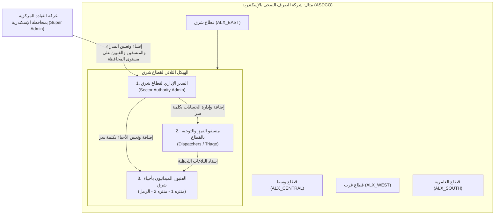

# المخطط الهيكلي المتكامل: إدارة الموظفين بالقطاعات والهيكل الثلاثي للهيئات
**وثيقة مرجعية تقنية وتشغيلية محدثة - منظومة "مدينتي" بمحافظة الإسكندرية**
*تاريخ التحديث: نوفمبر 2026 | الإصدار: 2.0.0*

---

## 1. الرؤية الهندسية ومبدأ التوزيع القطاعي

لمواجهة الكثافة التشغيلية الكبيرة في محافظة الإسكندرية والتحديات الموسمية للنوّات الشتوية، تم اعتماد **اللامركزية القطاعية الذكية (Decentralized Sector-Based Management)**:

1. **الجهات الخدمية الست الحقيقية (`Authorities`):**
   * شركة الصرف الصحي بالإسكندرية (`ASDCO`).
   * شركة مياه الشرب بالإسكندرية (`AWCO`).
   * شركة نهضة مصر للنظافة والخدمات البيئية (`Nahdet Misr`).
   * شركة الإسكندرية لتوزيع الكهرباء (`AEDC`).
   * مديرية الطرق والنقل بمحافظة الإسكندرية.
   * الإدارة المركزية للسياحة والمصايف (الكورنيش والشواطئ).

2. **القطاعات الأربعة المعتمدة لكل هيئة (`The 4 Macro Sectors`):**
   * **`ALX_EAST` (قطاع شرق الإسكندرية):** حي المنتزه أول، حي المنتزه ثان، وحي شرق.
   * **`ALX_CENTRAL` (قطاع وسط والمدينة التاريخية):** حي وسط، حي الجمرك، وحي غرب.
   * **`ALX_WEST` (قطاع غرب والساحل):** حي العجمي *(ويشمل إدارياً الدخيلة، البيطاش، الهانوفيل، أبو يوسف، والكيلو 21)*.
   * **`ALX_SOUTH` (قطاع العامرية والجنوب الصناعي):** حي العامرية أول، حي العامرية ثان، ومركز ومدينة برج العرب.

3. **الهيكل الثلاثي داخل كل قطاع في كل هيئة (The Tripartite Sector Hierarchy):**
   لكل هيئة في كل قطاع هيكل ثلاثي متكامل الأدوار والصلاحيات:
   * **مدير إداري للقطاع (`Sector Authority Admin`):** يختص بالشؤون الإدارية وإدارة طاقم قطاعه فقط.
   * **منسق فرز وتوجيه للقطاع (`Sector Dispatcher / Triage`):** متفرغ للرصد اللحظي وتوزيع البلاغات.
   * **فني ميداني (`Field Technician / Operator`):** فرق الصيانة الميدانية في شوارع وأحياء القطاع.

---

## 2. الهيكل التنظيمي ومصفوفة الصلاحيات بالكامل



---

## 3. تفصيل الأدوار والصلاحيات الإدارية والتشغيلية

### 0. مدير المنظومة العام بالمحافظة (`ADMIN` - Super Admin)
* **صلاحياته في قسم «إدارة الموظفين والهيئات»:**
  * عرض جميع الموظفين عبر كافة الهيئات الـ 6 والقطاعات الـ 4 مع فلاتر متقدمة (بالجهة، بالقطاع، بالدور، بالحالة).
  * **إضافة أي دور وظيفي في المنظومة وتعيين الجهة والقطاع له:**
    * إضافة **مدير إداري للقطاع (`AUTHORITY_ADMIN`)** مع تحديد الجهة المختصة والقطاع المسؤول عنه (`شرق` / `وسط` / `غرب` / `العامرية`).
    * إضافة **منسق فرز وتوجيه (`TRIAGE`)** مباشرةً لأي جهة وقطاع.
    * إضافة **فني ميداني (`OPERATOR`)** مباشرةً لأي جهة وقطاع وتعيين الحي المسؤول عنه.
  * تجميد أو تفعيل الحسابات وإعادة تعيين كلمات المرور أو نقل الموظف بين القطاعات.

### 1. المدير الإداري للقطاع (`Sector Authority Admin`)
* **كيف يتم إنشاؤه؟**
  * يقوم **مدير المنظومة العام بالمحافظة (`ADMIN`)** بإنشاء حسابه، مع **تحديد إلزامي للهيئة والقطاع المسؤول عنه فقط** من بين القطاعات الـ 4 (مثال: *"المدير الإداري لقطاع شرق بشركة الصرف الصحي"*).
* **صلاحياته ومسؤولياته في قسم «إدارة فريق القطاع»:**
  * يقتصر نطاقه الإداري والرقابي على **جهته وقطاعه المحدد فقط**؛ ولا يملك صلاحية رؤية أو إدارة أي موظف خارج قطاعه أو جهته.
  * **إضافة وإدارة موظفي قطاعه:**
    * إضافة **منسقي الفرز والتوجيه (`TRIAGE`)** داخل قطاعه.
    * إضافة **الفنيين الميدانيين (`OPERATOR`)** وتوزيعهم على أحياء قطاعه فقط.
    * تعيين البريد الإلكتروني وكلمة المرور لكل موظف ينشئه.
    * تجميد الحسابات (`Suspend`) أو إعادة تفعيلها أو تغيير كلمات المرور داخل قطاعه فقط.
  * لا يُسمح له بإنشاء حسابات `AUTHORITY_ADMIN` أو `ADMIN`.
  * مراقبة مؤشرات الأداء وزمن الاستجابة (SLA) الخاصة بقطاعه.

---

### 2. منسق الفرز والتوجيه بالقطاع (`Sector Dispatcher / Triage`)
* **كيف يتم إنشاؤه؟**
  * ينشئه المدير الإداري للقطاع التابع له، ويكون مربوطاً تلقائياً بنفس القطاع.
* **طبيعة عمله وصلاحياته:**
  * **عمل تشغيلي لحظي بنسبة 100%:** جالس أمام شاشة المراقبة وغرفة الطوارئ / الخط الساخن.
  * يرى فقط البلاغات الواردة في **قطاعه المحدد** (مثلاً منسق قطاع شرق يرى فقط بلاغات المنتزه أول، المنتزه ثان، والرمل).
  * فحص البلاغ ومراجعة الصورة والذكاء الاصطناعي، وتحديد درجة الخطورة.
  * إسناد البلاغ فوراً للفني الميداني الأقرب أو فرقة الصيانة المسؤولة في الحي.
  * **خالٍ من أي أعباء إدارية:** لا ينشغل بإنشاء حسابات أو كلمات سر أو أمور إدارية.

---

### 3. الفني الميداني (`Field Technician / Operator`)
* **كيف يتم إنشاؤه؟**
  * ينشئه المدير الإداري للقطاع، ويحدد له الحي التابع له داخل القطاع (مثلاً: فرقة صيانة حي المنتزه أول - سيدي بشر).
* **طبيعة عمله وصلاحياته:**
  * استخدام الهاتف المحمول أو التابلت في سيارة الصيانة والمعدات الميدانية.
  * استلام البلاغات المحالة إليه في حيه، والضغط على **"بدء العمل" (`IN_PROGRESS`)**.
  * بعد شفط المياه، أو إصلاح الماسورة، أو إنارة العمود، يلتقط صورة الإثبات بعد الإصلاح ويكتب توثيقاً مختصراً.
  * الضغط على **"تم الإصلاح" (`RESOLVED`)** لتصل رسالة فورية للمواطن وغرفة العمليات.

---

## 4. المعمارية التقنية وقاعدة البيانات (Database & API Design)

### 4.1 تحديث نماذج قاعدة البيانات (`AuthorityMembership` و `ServiceArea` و `Report`)
يتم ربط كل موظف، وكل حي (`ServiceArea`)، وكل بلاغ (`Report`) بالقطاع المعتمد لضمان التوجيه الآلي والعزل القطاعي الكامل:

```prisma
enum AlexandriaSector {
  ALX_EAST      // قطاع شرق (المنتزه أول، المنتزه ثان، شرق)
  ALX_CENTRAL   // قطاع وسط (وسط، الجمرك، غرب)
  ALX_WEST      // قطاع غرب والساحل (العجمي ويشمل الدخيلة)
  ALX_SOUTH     // قطاع العامرية والجنوب (العامرية أول، العامرية ثان، برج العرب)
}

model AuthorityMembership {
  id             String            @id @default(cuid())
  userId         String
  user           User              @relation(fields: [userId], references: [id], onDelete: Cascade)
  authorityId    String
  authority      Authority         @relation(fields: [authorityId], references: [id], onDelete: Cascade)
  membershipRole MembershipRole    @default(OPERATOR) // AUTHORITY_ADMIN | TRIAGE | OPERATOR | VIEWER
  sector         AlexandriaSector? // القطاع الإلزامي للمدير والموظفين
  assignedAreaId String?           // الحي التابع له الفني داخل القطاع
  isActive       Boolean           @default(true)
  createdAt      DateTime          @default(now())
  updatedAt      DateTime          @updatedAt

  @@unique([userId, authorityId])
  @@index([userId, isActive])
  @@index([authorityId, sector, isActive])
}
```

* **تحديث `ServiceArea`:** إضافة `sector AlexandriaSector` و`code String @unique` (مثل `ALX-MON1`..`ALX-BRG`) لربط الأحياء العشرة تلقائياً بقطاعاتها الأربعة.
* **تحديث `Report`:** إضافة `serviceAreaId String?` و`sector AlexandriaSector?` يتم حسابهما تلقائياً عند إنشاء البلاغ من إحداثيات الموقع (`latitude`, `longitude`) ليرى منسق الفرز (`TRIAGE`) بلاغات قطاعه حصرياً.

---

### 4.2 واجهات البرمجة الخلفية المقيدة بالقطاع (APIs with Sector Enforcement)

#### 1. `GET /api/admin/staff`
* **إذا كان الطالب مدير المحافظة (`ADMIN`):** يرى جميع الموظفين في كل الهيئات والقطاعات مع فلتر للجهة، القطاع، والدور.
* **إذا كان الطالب مديراً إدارياً لقطاع (`AUTHORITY_ADMIN`):** 
  * يقرأ النظام قطاعه وهيئته تلقائياً من جلسته:
  * يجلب **حصرياً** موظفي نفس الهيئة ونفس القطاع.

#### 2. `POST /api/admin/staff` (إنشاء موظف جديد)
* **قواعد التحقق الصارمة (Strict Business Rules):**
  1. **مدير المحافظة (`ADMIN`):**
     * يُسمح له بإنشاء كافة الأدوار القطاعية: **مدير إداري للقطاع (`AUTHORITY_ADMIN`)**، **منسق فرز (`TRIAGE`)**، أو **فني ميداني (`OPERATOR`)**.
     * يحدد إلزامياً الجهة (`authorityId`) والقطاع (`sector`)، والحي (`assignedAreaId`) اختياري أو إلزامي للفني الميداني.
  2. **المدير الإداري للقطاع (`AUTHORITY_ADMIN`):**
     * يُسمح له بإنشاء دورين فقط: **منسق فرز (`TRIAGE`)** أو **فني ميداني (`OPERATOR`)**.
     * حقلا الجهة (`authorityId`) والقطاع (`sector`) يُفرضان تلقائياً من جلسة المدير المنشئ ولا يمكنه تغييره لجهة أو قطاع آخر.
     * إذا اختار حياً (`assignedAreaId`)، يتحقق الخادم من أن الحي ينتمي لنفس قطاع المدير.
  3. **الأمان:** كلمة المرور تُشفر عبر `better-auth/crypto` (`hashPassword`).

#### 3. `PATCH /api/admin/staff/[id]`
* تجميد أو تفعيل حساب الموظف، أو تغيير كلمة سره أو الحي المعيّن له؛ يُسمح لـ `ADMIN` على كافة القطاعات، ويُسمح لـ `AUTHORITY_ADMIN` على موظفي جهته وقطاعه فقط (IDOR Protection).

---

## 5. واجهة الاستخدام وتجربة المسؤول (UI / UX)

### 5.1 قسم الموظفين ونافذة إضافة الموظف (Modal):
1. **عندما يفتحها مدير المحافظة العام (`ADMIN`) في قسم «إدارة الموظفين والهيئات»:**
   * اختيار الجهة (الصرف الصحي، المياه، نهضة مصر، الكهرباء، الطرق، السياحة والمصايف).
   * اختيار القطاع المسؤول عنه (`شرق` / `وسط` / `غرب` / `العامرية`).
   * اختيار الدور:
     * 🟣 **مدير إداري للقطاع** (`AUTHORITY_ADMIN`).
     * 🔵 **منسق فرز وتوجيه** (`TRIAGE`).
     * 🟢 **فني ميداني** (`OPERATOR`) — مع قائمة أحياء القطاع المختار تلقائياً.
   * الاسم، البريد الإلكتروني، رقم الهاتف، وكلمة المرور.
2. **عندما يفتحها المدير الإداري للقطاع في قسم «إدارة فريق القطاع»:**
   * اسم الجهة واسم القطاع يظهران كشارة ثابتة غير قابلة للتغيير: *(مثلاً: شركة الصرف الصحي - قطاع شرق)*.
   * خيار تحديد الدور (مقصور على التشغيل الميداني):
     * 🔵 **منسق فرز وتوجيه** (غرفة العمليات والبلاغات اللحظية).
     * 🟢 **فني ميداني** (مع قائمة منسدلة بأحياء قطاعه فقط).
   * الاسم، البريد الإلكتروني، رقم الهاتف، وكلمة المرور.

---

## 6. مصفوفة القطاعات والأحياء الأربعة في الإسكندرية

| كود القطاع | اسم القطاع | الأحياء الرسمية التابعة للقطاع | طبيعة التحديات الميدانية |
| :--- | :--- | :--- | :--- |
| **`ALX_EAST`** | **قطاع شرق الإسكندرية** | • حي المنتزه أول (سيدي بشر، ميامي)<br>• حي المنتزه ثان (المندرة، المعمورة، أبو قير)<br>• حي شرق (سموحة، سيدي جابر، جناكليس، الرمل) | نوّات وأمطار، أنفاق حيوية (نفق 45، المندرة، سيدي جابر)، كثافة سياحية |
| **`ALX_CENTRAL`** | **قطاع وسط والتاريخي** | • حي وسط (محرم بك، الشاطبي، الأزاريطة)<br>• حي الجمرك (رأس التين، المنشية، الأنفوشي، بحري)<br>• حي غرب (كرموز، الورديان، القباري، الميناء) | مبانٍ وشبكات مياه وصرف قديمة وتاريخية، حركة شاحنات الميناء |
| **`ALX_WEST`** | **قطاع غرب والساحل** | • حي العجمي *(ويشمل إدارياً: الدخيلة، البيطاش، الهانوفيل، أبو يوسف، والكيلو 21)* | مياه جوفية، امتداد ساحلي سريع النمو، خطوط صرف صحي تحت التطوير |
| **`ALX_SOUTH`** | **قطاع العامرية والجنوب** | • حي العامرية أول (مرغم، عبد القادر)<br>• حي العامرية ثان (كينج مريوط، الناصرية)<br>• مركز ومدينة برج العرب | طرق سريعة وصحراوية، مصانع، مساحات جغرافية متباعدة |

---

## 7. خطة العمل المباشرة للتنفيذ (Roadmap)

1. **الخطوة 1: تحديث الـ Schema وقاعدة البيانات:**
   * إضافة `AlexandriaSector` وربط `sector` في `AuthorityMembership` و`ServiceArea` و`Report` (مع تحديد `serviceAreaId` و`sector` تلقائياً من الإحداثيات عند إنشاء البلاغ).
2. **الخطوة 2: تحديث بيانات التأسيس (`seed.ts`) والذكاء الاصطناعي:**
   * إدراج الهيئات الـ 6، والأحياء الـ 10 (بما فيها الدخيلة ضمن حي العجمي)، وتحديث `lib/ai/gemini.ts` والواجهة، وإنشاء حسابات المدراء الإداريين للقطاعات الأربعة لكل هيئة، مع حسابات تجريبية للمنسقين والفنيين بكلمة مرور موحدة مُشفّرة مسبقاً.
3. **الخطوة 3: بناء الـ APIs المؤمّنة بالقطاع:**
   * `app/api/admin/staff/route.ts` و`app/api/admin/staff/[id]/route.ts` مع دعم صلاحيات `ADMIN` (إضافة مدير قطاع / منسق / فني) وصلاحيات `AUTHORITY_ADMIN` (إضافة منسق / فني داخل قطاعه فقط) وحماية IDOR.
4. **الخطوة 4: واجهة قسم الموظفين وفلاتر لوحة التحكم:**
   * إضافة قسم **«إدارة الموظفين والهيئات»** للـ `ADMIN` وقسم **«إدارة فريق القطاع»** لمدير القطاع، وفلاتر البلاغات بالقطاع والحي، وتحديث مركز الخريطة الرئيسي للإسكندرية (`31.2001, 29.9187`).
5. **الخطوة 5: التحقق والاختبارات:**
   * تشغيل `typecheck` و `lint` واختبارات الصلاحيات للتأكد من عدم وجود أي خطأ.

---
*تم اعتماد هذه الوثيقة كمرجع نهائي لكافة أعمال التطوير.*
