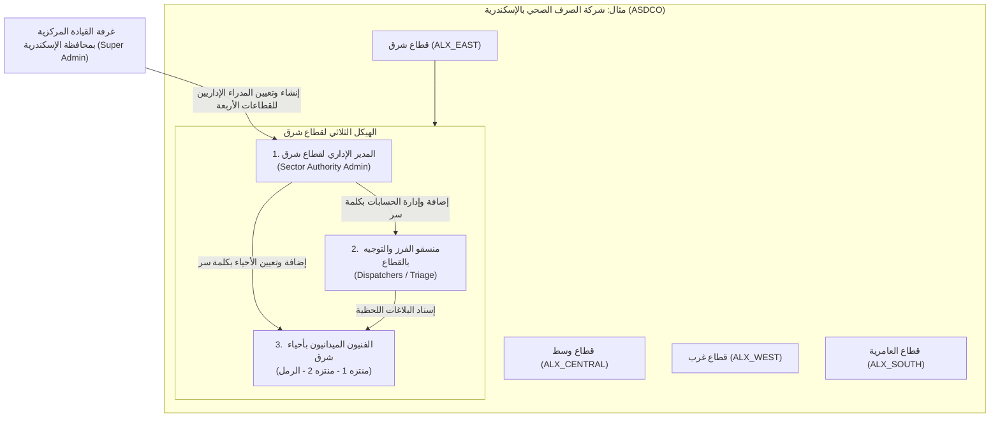

# المخطط الهيكلي المتكامل: إدارة الموظفين بالقطاعات والهيكل الثلاثي للهيئات
**وثيقة مرجعية تقنية وتشغيلية محدثة - منظومة "مدينتي" بمحافظة الإسكندرية**
*تاريخ التحديث: نوفمبر 2026 | الإصدار: 2.0.0*

---

## 1. الرؤية الهندسية ومبدأ التوزيع القطاعي

لمواجهة الكثافة التشغيلية الكبيرة في محافظة الإسكندرية والتحديات الموسمية للنوّات الشتوية، تم اعتماد **اللامركزية القطاعية الذكية (Decentralized Sector-Based Management)**:

1. **الجهات الخدمية الست الحقيقية (`Authorities`):**
   * شركة الصرف الصحي بالإسكندرية (`ASDCO`).
   * شركة مياه الشرب بالإسكندرية (`AWCO`).
   * شركة نهضة مصر للنظافة والخدمات البيئية (`Nahdet Misr`).
   * شركة الإسكندرية لتوزيع الكهرباء (`AEDC`).
   * مديرية الطرق والنقل بمحافظة الإسكندرية.
   * الإدارة المركزية للسياحة والمصايف (الكورنيش والشواطئ).

2. **القطاعات الأربعة المعتمدة لكل هيئة (`The 4 Macro Sectors`):**
   * **`ALX_EAST` (قطاع شرق الإسكندرية):** المنتزه أول، المنتزه ثان، وحي الرمل وشرق.
   * **`ALX_CENTRAL` (قطاع وسط والمدينة التاريخية):** حي وسط، حي الجمرك وبحري، وحي غرب.
   * **`ALX_WEST` (قطاع غرب والساحل):** حي العجمي وحي الدخيلة.
   * **`ALX_SOUTH` (قطاع العامرية والجنوب الصناعي):** حي العامرية أول، حي العامرية ثان، ومركز ومدينة برج العرب.

3. **الهيكل الثلاثي داخل كل قطاع في كل هيئة (The Tripartite Sector Hierarchy):**
   لكل هيئة في كل قطاع هيكل ثلاثي متكامل الأدوار والصلاحيات:
   * **مدير إداري للقطاع (`Sector Authority Admin`):** يختص بالشؤون الإدارية وإدارة طاقم قطاعه فقط.
   * **منسق فرز وتوجيه للقطاع (`Sector Dispatcher / Triage`):** متفرغ للرصد اللحظي وتوزيع البلاغات.
   * **فني ميداني (`Field Technician / Operator`):** فرق الصيانة الميدانية في شوارع وأحياء القطاع.

---

## 2. الهيكل التنظيمي ومصفوفة الصلاحيات بالكامل



---

## 3. تفصيل الأدوار الثلاثة لكل قطاع

### 1. المدير الإداري للقطاع (`Sector Authority Admin`)
* **كيف يتم إنشاؤه؟**
  * يقوم **مدير المنظومة العام بالمحافظة (`ADMIN`)** بإنشاء حسابه، مع **تحديد إلزامي للهيئة والقطاع المسؤول عنه فقط** من بين القطاعات الـ 4 (مثال: *"المدير الإداري لقطاع شرق بشركة الصرف الصحي"*).
* **صلاحياته ومسؤولياته:**
  * يقتصر نطاقه الإداري والرقابي على **قطاعه المحدد فقط**؛ ولا يملك صلاحية رؤية أو إدارة أي موظف خارج قطاعه.
  * **هو المسؤول الوحيد في قطاعه عن إضافة وإدارة حسابات الموظفين**:
    * إضافة منسقي الفرز والتوجيه (`Triage`).
    * إضافة الفنيين الميدانيين (`Field Technicians`) وتوزيعهم على أحياء القطاع.
    * تعيين البريد الإلكتروني وكلمة المرور لكل موظف.
    * تجميد الحسابات (`Suspend`) أو إعادة تفعيلها أو تغيير كلمات المرور.
  * مراقبة مؤشرات الأداء وزمن الاستجابة (SLA) الخاصة بقطاعه.

---

### 2. منسق الفرز والتوجيه بالقطاع (`Sector Dispatcher / Triage`)
* **كيف يتم إنشاؤه؟**
  * ينشئه المدير الإداري للقطاع التابع له، ويكون مربوطاً تلقائياً بنفس القطاع.
* **طبيعة عمله وصلاحياته:**
  * **عمل تشغيلي لحظي بنسبة 100%:** جالس أمام شاشة المراقبة وغرفة الطوارئ / الخط الساخن.
  * يرى فقط البلاغات الواردة في **قطاعه المحدد** (مثلاً منسق قطاع شرق يرى فقط بلاغات المنتزه أول، المنتزه ثان، والرمل).
  * فحص البلاغ ومراجعة الصورة والذكاء الاصطناعي، وتحديد درجة الخطورة.
  * إسناد البلاغ فوراً للفني الميداني الأقرب أو فرقة الصيانة المسؤولة في الحي.
  * **خالٍ من أي أعباء إدارية:** لا ينشغل بإنشاء حسابات أو كلمات سر أو أمور إدارية.

---

### 3. الفني الميداني (`Field Technician / Operator`)
* **كيف يتم إنشاؤه؟**
  * ينشئه المدير الإداري للقطاع، ويحدد له الحي التابع له داخل القطاع (مثلاً: فرقة صيانة حي المنتزه أول - سيدي بشر).
* **طبيعة عمله وصلاحياته:**
  * استخدام الهاتف المحمول أو التابلت في سيارة الصيانة والمعدات الميدانية.
  * استلام البلاغات المحالة إليه في حيه، والضغط على **"بدء العمل" (`IN_PROGRESS`)**.
  * بعد شفط المياه، أو إصلاح الماسورة، أو إنارة العمود، يلتقط صورة الإثبات بعد الإصلاح ويكتب توثيقاً مختصراً.
  * الضغط على **"تم الإصلاح" (`RESOLVED`)** لتصل رسالة فورية للمواطن وغرفة العمليات.

---

## 4. المعمارية التقنية وقاعدة البيانات (Database & API Design)

### 4.1 تحديث نموذج العضوية (`AuthorityMembership`)
يتم ربط كل موظف بقطاعه المعتمد:

```prisma
enum AlexandriaSector {
  ALX_EAST      // قطاع شرق (منتزه 1، منتزه 2، الرمل وشرق)
  ALX_CENTRAL   // قطاع وسط (وسط، الجمرك وبحري، غرب)
  ALX_WEST      // قطاع غرب والساحل (العجمي والدخيلة)
  ALX_SOUTH     // قطاع العامرية والجنوب (عامرية 1، عامرية 2، برج العرب)
}

model AuthorityMembership {
  id             String            @id @default(cuid())
  userId         String
  user           User              @relation(fields: [userId], references: [id], onDelete: Cascade)
  authorityId    String
  authority      Authority         @relation(fields: [authorityId], references: [id], onDelete: Cascade)
  membershipRole MembershipRole    @default(OPERATOR) // AUTHORITY_ADMIN | TRIAGE | OPERATOR | VIEWER
  sector         AlexandriaSector? // القطاع الإلزامي للمدير والموظفين
  assignedAreaId String?           // الحي التابع له الفني داخل القطاع
  isActive       Boolean           @default(true)
  createdAt      DateTime          @default(now())
  updatedAt      DateTime          @updatedAt

  @@unique([userId, authorityId])
  @@index([userId, isActive])
  @@index([authorityId, sector, isActive])
}
```

---

### 4.2 واجهات البرمجة الخلفية المقيدة بالقطاع (APIs with Sector Enforcement)

#### 1. `GET /api/admin/staff`
* **إذا كان الطالب مدير المحافظة (`ADMIN`):** يرى جميع الموظفين في كل الهيئات والقطاعات مع فلتر للقطاع والهيئة.
* **إذا كان الطالب مديراً إدارياً لقطاع (`AUTHORITY_ADMIN`):** 
  * يقرأ النظام قطاعه وهيئته تلقائياً من جلسته:
  * يجلب **حصرياً** موظفي نفس الهيئة ونفس القطاع.

#### 2. `POST /api/admin/staff` (إنشاء موظف جديد)
* **قواعد التحقق الصارمة (Strict Business Rules):**
  1. **المدير الإداري للقطاع:**
     * يُسمح له بإنشاء دورين فقط: **منسق فرز (`TRIAGE`)** أو **فني ميداني (`OPERATOR`)**.
     * حقل القطاع `sector` يُفرض تلقائياً من قطاع المدير المنشئ ولا يمكن للمدير تغييره لقطاع آخر.
     * كلمة المرور تُشفر بـ `better-auth/crypto` (`hashPassword`).
  2. **مدير المحافظة (`ADMIN`):**
     * هو الوحيد المخول بإنشاء **المدير الإداري للقطاع (`AUTHORITY_ADMIN`)** وتعيين قطاعه المعتمد.

#### 3. `PATCH /api/admin/staff/[id]`
* تجميد حساب الفني أو المنسق في القطاع، أو تغيير كلمة سره، مع منع أي مدير قطاع من تعديل حسابات قطاع آخر (IDOR Protection).

---

## 5. واجهة الاستخدام وتجربة المسؤول (UI / UX)

### 5.1 نافذة إضافة الموظف (Modal):
1. **عندما يفتحها مدير المحافظة العام (`ADMIN`):**
   * خيار لاختيار الهيئة (الصرف الصحي، المياه، الكهرباء...).
   * خيار لاختيار القطاع المسؤول عنه (`شرق` / `وسط` / `غرب` / `العامرية`).
   * اختيار الدور: **مدير إداري للقطاع**.
2. **عندما يفتحها المدير الإداري للقطاع:**
   * اسم الهيئة واسم القطاع يظهران كشارة ثابتة غير قابلة للتغيير: *(مثلاً: شركة الصرف الصحي - قطاع شرق)*.
   * خيار تحديد الدور:
     * 🔵 **منسق فرز وتوجيه** (غرفة العمليات والبلاغات اللحظية).
     * 🟢 **فني ميداني** (مع قائمة منسدلة بأحياء القطاع: منتزه أول / منتزه ثان / الرمل).
   * الاسم، البريد، رقم الهاتف، وكلمة المرور.

---

## 6. مصفوفة القطاعات والأحياء الأربعة في الإسكندرية

| كود القطاع | اسم القطاع | الأحياء الرسمية التابعة للقطاع | طبيعة التحديات الميدانية |
| :--- | :--- | :--- | :--- |
| **`ALX_EAST`** | **قطاع شرق الإسكندرية** | • حي المنتزه أول (سيدي بشر، ميامي)<br>• حي المنتزه ثان (المندرة، المعمورة، أبو قير)<br>• حي الرمل وشرق (سموحة، سيدي جابر، جناكليس) | نوّات وأمطار، أنفاق حيوية (نفق 45، المندرة، سيدي جابر)، كثافة سياحية |
| **`ALX_CENTRAL`** | **قطاع وسط والتاريخي** | • حي وسط (محرم بك، الشاطبي، الأزاريطة)<br>• حي الجمرك وبحري (رأس التين، المنشية، الأنفوشي)<br>• حي غرب (كرموز، الورديان، القباري، الميناء) | مبانٍ وشبكات مياه وصرف قديمة وتاريخية، حركة شاحنات الميناء |
| **`ALX_WEST`** | **قطاع غرب والساحل** | • حي العجمي (البيطاش، الهانوفيل، الكيلو 21)<br>• حي الدخيلة | مياه جوفية، امتداد ساحلي سريع النمو، خطوط صرف صحي تحت التطوير |
| **`ALX_SOUTH`** | **قطاع العامرية والجنوب** | • حي العامرية أول (مرغم، عبد القادر)<br>• حي العامرية ثان (كينج مريوط، الناصرية)<br>• مركز ومدينة برج العرب | طرق سريعة وصحراوية، مصانع، مساحات جغرافية متباعدة |

---

## 7. خطة العمل المباشرة للتنفيذ (Roadmap)

1. **الخطوة 1: تحديث الـ Schema وقاعدة البيانات:**
   * إضافة `AlexandriaSector` وربط `sector` في `AuthorityMembership`.
2. **الخطوة 2: تحديث بيانات التأسيس (`seed.ts`):**
   * إدراج الهيئات الـ 6، والأحياء الـ 10، وإنشاء حسابات المدراء الإداريين للقطاعات الأربعة لكل هيئة، مع حسابات تجريبية للمنسقين والفنيين.
3. **الخطوة 3: بناء الـ APIs المؤمّنة بالقطاع:**
   * `app/api/admin/staff/route.ts` مع حماية النطاق القطاعي (`sector`).
4. **الخطوة 4: واجهة إدارة الطاقم وفلاتر لوحة التحكم:**
   * شاشات وجداول الموظفين المفلترة قطاعياً، وتحديث مركز الخريطة الرئيسي للإسكندرية (`31.2001, 29.9187`).
5. **الخطوة 5: التحقق والاختبارات:**
   * تشغيل `typecheck` و `lint` واختبارات الصلاحيات للتأكد من عدم وجود أي خطأ.

---
*تم اعتماد هذه الوثيقة كمرجع نهائي لكافة أعمال التطوير.*
